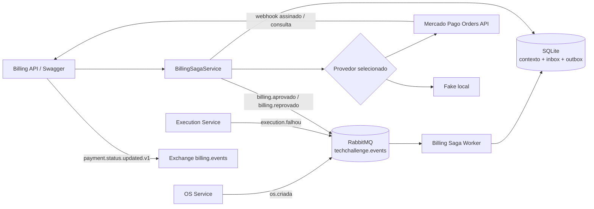

# Billing Service — Tech Challenge FIAP PósTech, Fase 4

Serviço de faturamento em ASP.NET Core responsável por registrar orçamentos vinculados a ordens de serviço, solicitar pagamentos Pix e coordenar decisões e compensações financeiras. Participa de uma Saga coreografada com os serviços de OS e Execution por eventos RabbitMQ.

> O Compose lê `MercadoPago__AccessToken` do ambiente. Se você usava a credencial anteriormente gravada no arquivo, revogue-a no Mercado Pago e configure uma nova no seu ambiente local.

## 1. Visão geral e responsabilidades

O Billing:

- recebe `os.criada` e registra o identificador da OS;
- gera e persiste um orçamento com valor fornecido à API;
- inicia uma cobrança Pix e só aprova a Saga depois da confirmação financeira;
- permite reprovar explicitamente um orçamento ainda sem pagamento iniciado;
- publica `billing.aprovado` ou `billing.reprovado`;
- ao receber `execution.falhou`, tenta cancelar um Pix pendente ou estornar um pagamento confirmado, e acompanha a confirmação;
- mantém o contexto financeiro, a inbox e a outbox em SQLite.

Não cria OS, calcula preços a partir de catálogo, autentica clientes ou executa serviços. A aprovação do orçamento é distinta da aprovação financeira do pagamento.

## 2. Arquitetura e estrutura do projeto

O diagrama dos três microsserviços, o fluxo da Saga e as justificativas das escolhas técnicas estão na [documentação da arquitetura final](docs/architecture/arquitetura-final.md).



Estrutura principal:

| Caminho | Responsabilidade |
| --- | --- |
| `src/Billing.Api/Controllers/` | Endpoints de orçamento, pagamentos e webhook. |
| `src/Billing.Api/Saga/` | Contratos, regras, workers RabbitMQ e store SQLite da Saga. |
| `src/Billing.Api/Integrations/` | Cliente Mercado Pago, Fake e validação da assinatura do webhook. |
| `src/Billing.Api/Messaging/` | Evento financeiro v1 e publicador RabbitMQ. |
| `src/Billing.Api/Infrastructure/` | Tratamento de erros de integração. |
| `tests/Billing.Api.Tests/` | Testes de API, Saga, Fake, webhook e RabbitMQ. |
| `docs/saga-minima.md` | Roteiro e configuração detalhados da coreografia. |
| `docs/architecture/adr-0001-saga-os.md` | Decisão histórica de orquestração, substituída pela coreografia atual. |

O Billing persiste seu próprio estado. Os outros serviços não acessam diretamente seu banco.

## 3. Tecnologias utilizadas

- .NET 10 / C# e ASP.NET Core Web API;
- SQLite (`Microsoft.Data.Sqlite`) para estado durável local;
- RabbitMQ (`RabbitMQ.Client`) para consumo e publicação de eventos;
- Mercado Pago Orders API para cobrança Pix, consulta, cancelamento e estorno;
- provedor Fake, isolado para `Development` e `Testing`;
- Swagger/Swashbuckle, Docker e Docker Compose;
- xUnit e `Microsoft.AspNetCore.Mvc.Testing` para testes.

## 4. Pré-requisitos

- SDK .NET 10 (o `global.json` fixa `10.0.100` e aceita atualizações de feature);
- Docker com suporte a containers Linux para a imagem ASP.NET;
- RabbitMQ acessível pela API para executar a Saga e publicar o evento financeiro;
- credenciais próprias de aplicação/conta de teste do Mercado Pago para testar a integração real;
- PowerShell nos exemplos abaixo.

## 5. Configuração das variáveis de ambiente

O ASP.NET Core aceita variáveis de ambiente com `__` como separador de seção. Em desenvolvimento, prefira User Secrets; `scripts\Set-LocalSecrets.ps1` solicita o token com entrada oculta e permite configurar o segredo do webhook. User Secrets ficam fora do repositório, mas não são um cofre criptografado.

| Configuração | Variável | Padrão / uso |
| --- | --- | --- |
| Provedor | `Payment__Provider` | `MercadoPago`; use `Fake` somente em `Development` ou `Testing`. |
| Access Token | `MercadoPago__AccessToken` | Obrigatório para chamadas ao Mercado Pago. |
| Segredo do webhook | `MercadoPago__WebhookSecret` | Obrigatório para aceitar notificações assinadas. |
| URL base do provedor | `MercadoPago__BaseUrl` | Opcional; por padrão `https://api.mercadopago.com/`. |
| RabbitMQ | `RabbitMq__HostName`, `RabbitMq__Port`, `RabbitMq__VirtualHost`, `RabbitMq__UserName`, `RabbitMq__Password` | Por padrão, conexão local em `localhost:5672`. |
| Publicação financeira | `RabbitMq__Exchange`, `RabbitMq__Queue`, `RabbitMq__PublishTimeoutSeconds` | Padrões: `billing.events`, `billing.payment-status`, 5 segundos. |
| Saga | `Saga__Enabled`, `Saga__Exchange`, `Saga__Queue` | Padrões: `true`, `techchallenge.events`, `billing-service.events`. |
| SQLite e polling | `Saga__DatabasePath`, `Saga__PollSeconds`, `Saga__MaxFailures` | Padrões: `.data/billing.db`, 5 segundos e 10 falhas. |
| CORS | `Cors__AllowedOrigins__0` (e índices seguintes) | `appsettings.json` libera localhost nas portas 3000, 4200 e 5173. |
| Ambiente ASP.NET | `ASPNETCORE_ENVIRONMENT` | Swagger e Fake ficam disponíveis em `Development`; Fake também em `Testing`. |

Exemplo de configuração local sem expor o segredo no comando:

```powershell
.\scripts\Set-LocalSecrets.ps1
$env:Payment__Provider = 'MercadoPago'
```

Não grave tokens, segredo de webhook ou senha real em `appsettings*.json`, README, Git ou frontend. Um arquivo `.env` não é carregado automaticamente pelo ASP.NET Core.

## 6. Execução local e com Docker Compose

### Execução local

Configure User Secrets e disponibilize um RabbitMQ que a aplicação consiga acessar. O processo da API pode iniciar sem broker, mas os workers da Saga tentarão reconectar; eventos e webhooks dependentes de publicação não serão concluídos enquanto o broker estiver indisponível.

```powershell
dotnet restore .\TechChallenge.BillingService.slnx
dotnet run --project .\src\Billing.Api\Billing.Api.csproj --launch-profile http
```

O perfil `http` inicia em `http://localhost:5080` com ambiente `Development`. Para desenvolvimento sem credenciais do Mercado Pago, consulte [Provedor Fake](#10-provedor-fake-para-desenvolvimento-e-testes).

### Docker Compose deste repositório

O `docker-compose.yaml` da raiz inicia apenas o container da API; não define um serviço RabbitMQ. Ele publica a API em `http://localhost:8082`, espera encontrar o broker pelo hostname `rabbitmq` e depende da rede Docker externa `tech-challenge-execution-service_default`. Portanto, não é uma composição autônoma: a rede e o broker precisam existir e ser acessíveis antes da inicialização.

Prepare a rede e o broker. Para usar o Mercado Pago, forneça `MercadoPago__AccessToken` no ambiente do Compose antes de iniciar o container.

```powershell
docker compose up -d --build
docker compose logs -f billing-api
```

O Compose monta o volume `billing_data` para o SQLite em `/app/.data`. O Dockerfile publica a aplicação na porta interna 8080. O Compose atual não declara healthcheck, não configura o RabbitMQ e não deve ser considerado pronto para produção.

## 7. Swagger e endpoints REST

Swagger UI é habilitado somente em `Development`: `http://localhost:5080/swagger` localmente (no Compose, porta host 8082). O endpoint `GET /health` apenas retorna `{"status":"healthy"}`; não verifica RabbitMQ, SQLite ou credenciais externas.

| Método | Rota | Uso |
| --- | --- | --- |
| `GET` | `/health` | Health simples da aplicação. |
| `POST` | `/api/payments/pix` | Criação de Pix pelo provedor configurado; exige `X-Idempotency-Key`. |
| `GET` | `/api/payments/{orderId}` | Consulta pelo ID da order retornado pelo provedor (`ORD...`). |
| `POST` | `/api/webhooks/mercado-pago` | Recebe webhook assinado de Orders do Mercado Pago. |
| `GET` | `/api/billing/ordens/{ordemServicoUniqueCode}` | Consulta o estado local da Saga; a OS precisa ter sido registrada por `os.criada`. |
| `POST` | `/api/billing/ordens/{ordemServicoUniqueCode}/orcamento` | Gera orçamento com `{"amount": 50.00}`. |
| `POST` | `/api/billing/ordens/{ordemServicoUniqueCode}/aprovar` | Inicia ou retoma pagamento; exige dados do pagador e `X-Idempotency-Key`. |
| `POST` | `/api/billing/ordens/{ordemServicoUniqueCode}/reprovar` | Reprova explicitamente orçamento ainda sem pagamento iniciado. |
| `POST` | `/api/billing/ordens/{ordemServicoUniqueCode}/reconciliar` | Retoma reconciliação suspensa; responde `202 Accepted`. |

Os endpoints de pagamento Pix independentes da Saga são mantidos por compatibilidade. O GET de uma OS retorna `decision`, `amount`, `paymentId`, `compensationRequested`, `compensationStatus` e `lastError`.

## 8. Geração e aprovação de orçamentos

`os.criada` deve ser consumido antes das operações de orçamento. O valor precisa ser positivo, ter no máximo duas casas decimais e não exceder `999999999.99`. O orçamento é imutável: repetir o mesmo valor é idempotente; enviar outro valor retorna conflito. Este repositório não calcula preço por catálogo nem valida preço em outro serviço.

Exemplo após registrar uma OS válida:

```powershell
$os = '6278720e-81c5-465f-8078-f2f623f3a945'
$base = 'http://localhost:5080'
Invoke-RestMethod -Method Post `
  -Uri "$base/api/billing/ordens/$os/orcamento" `
  -ContentType 'application/json' `
  -Body '{"amount":50.00}'
```

A aprovação exige um orçamento já gerado, e associa uma chave de idempotência ao payload (email e nome do pagador). Repetir exige a mesma chave e os mesmos dados. Não use outra chave para repetir uma operação cujo resultado ainda seja incerto.

## 9. Integração real com Mercado Pago

`MercadoPagoClient` chama a Orders API com Bearer Access Token. Cria order online/automática com método Pix, valor e `external_reference` apontando para a OS. A criação e as retentativas usam `X-Idempotency-Key`. O ID da cobrança é o `ORD...` retornado pelo provedor, não o identificador da OS.

O pagamento pode começar como `action_required`/`waiting_transfer`; isso não é confirmação. A Saga considera aprovado somente o estado consultado `processed`/`accredited`. A API aceita webhooks de Orders com assinatura HMAC validada, busca o ID assinado na Orders API e usa o estado consultado, não o corpo não assinado. Configure HTTPS público e o segredo do webhook no painel do Mercado Pago para testar esse caminho.

Os testes automatizados simulam respostas HTTP e não criam pagamentos externos. Use credenciais e pagadores de teste próprios para validar a integração real. O prefixo do token não é suficiente para concluir se a conta está em ambiente de teste ou produção.

### Rejeições e limites da API

Respostas HTTP 400 ou 422 do Mercado Pago são mapeadas para 422 no Billing, com detalhe genérico; o conteúdo sensível da resposta não é enviado ao cliente. Em operações de compensação, uma rejeição 422 não significa que houve estorno: o estado continua pendente, será reconciliado e pode chegar a `manual_review`. A API só marca estorno concluído após consultar uma order que confirme todos os refunds processados e o valor integral. Um `2xx` do pedido de estorno, por si só, não é confirmação financeira.

## 10. Provedor Fake para desenvolvimento e testes

Configure `Payment:Provider=Fake` apenas em `Development` ou `Testing`; em outros ambientes a aplicação recusa iniciar. O Fake grava cobranças na tabela local `fake_payments`, usa ID `ORD-FAKE-...`, aprova imediatamente (`processed`/`accredited`) e não cria QR Code ou cobrança externa.

```powershell
$env:Payment__Provider = 'Fake'
dotnet run --project .\src\Billing.Api\Billing.Api.csproj --launch-profile http
```

No Fake, a mesma chave e payload retornam a mesma cobrança; reutilizar a chave com payload diferente conflita. A compensação Fake conclui um estorno **somente no banco Fake/SQLite**. Não chama o Mercado Pago, não representa estorno real e não deve ser apresentado como tal. Cancelamento Fake não é suportado porque os pagamentos são aprovados imediatamente; para essa implementação a compensação é estorno Fake.

O provedor é selecionado e persistido na primeira aprovação de cada OS. Registros antigos sem provedor gravado são tratados como Mercado Pago; trocar a configuração global não converte pagamentos antigos para Fake.

## 11. Persistência SQLite

`Saga:DatabasePath` seleciona um arquivo SQLite (padrão `.data/billing.db`, relativo ao content root). O store ativa WAL e cria as tabelas `billing_orders`, `billing_inbox` e `billing_outbox`; quando o Fake é inicializado, também cria `fake_payments`. O contexto e os dados necessários para retomar uma criação ou compensação sobrevivem a reinícios.

Mantenha o arquivo em armazenamento persistente e faça backup de acordo com o ambiente. A implementação mínima suporta uma réplica e usa sincronização em processo; não compartilhe o mesmo arquivo como mecanismo de coordenação entre réplicas.

## 12. Eventos RabbitMQ consumidos e publicados

### Eventos da coreografia

Exchange topic durável, configurada por `Saga:Exchange` (padrão `techchallenge.events`); fila própria durável, `Saga:Queue` (padrão `billing-service.events`).

| Direção | Routing key | Efeito |
| --- | --- | --- |
| Consumido | `os.criada` | Registra a OS sem apagar orçamento ou decisão existente. |
| Consumido | `execution.falhou` | Registra pedido de compensação e agenda reconciliação. |
| Publicado | `billing.aprovado` | Apenas após confirmação de pagamento correspondente à OS e ao valor. |
| Publicado | `billing.reprovado` | Somente após reprovação explícita antes de iniciar pagamento. |

Os eventos de Saga usam JSON camelCase com `eventId` (Guid), `ordemServicoUniqueCode` (Guid) e `occurredAt` (UTC). A fila de entrada tem dead-letter exchange `<Saga:Exchange>.errors` e fila `<Saga:Queue>.error`; mensagens inválidas ou conflitantes recebem NACK sem requeue e vão para a DLQ.

### Evento financeiro legado

O webhook também publica `payment.status.updated.v1` na exchange `billing.events`, routing key `payment.status.updated.v1`, fila `billing.payment-status` (configuráveis pela seção `RabbitMq`). Contém `eventId`, `observedAt`, `paymentId`, `orderId`, `amount`, `status` e `statusDetail`; não inclui dados do pagador nem conteúdo Pix. Este contrato é separado dos eventos da Saga.

Os dois publicadores exigem publisher confirms e mensagem roteável. A outbox da Saga é despachada pelo worker; o evento financeiro legado é publicado durante o processamento do webhook e a resposta de sucesso só ocorre após confirmação do broker.

## 13. Participação na Saga coreografada

O Billing é um participante, não um orquestrador central. A OS Service publica `os.criada`; o Billing registra o contexto e disponibiliza operações de orçamento. Após o pagamento confirmado, publica `billing.aprovado` para o fluxo de execução. `execution.falhou` solicita compensação. O contrato atual não publica evento de compensação concluída.

O ADR-0001 descreve uma proposta histórica de orquestração. Para a integração implementada, consulte o contrato atualizado em [docs/saga-minima.md](docs/saga-minima.md).

## 14. Fluxo de aprovação de pagamento

1. A OS é registrada pela mensagem `os.criada`.
2. Um orçamento válido é gerado.
3. `POST .../aprovar` persiste provedor, chave e dados necessários antes da chamada externa.
4. O Billing cria ou recupera a cobrança com a mesma chave.
5. Se o provedor ainda indicar estado pendente, nenhum `billing.aprovado` é publicado. Webhook e worker de reconciliação consultam o estado mais recente.
6. Ao verificar `processed`/`accredited` para a mesma OS e o valor do orçamento, o Billing salva a decisão e a mensagem outbox `billing.aprovado`.
7. O worker publica com confirmação do broker e então marca o evento como enviado.

```text
os.criada → orçamento → pagamento confirmado → billing.aprovado → Execution
```

Com Fake, o pagamento é aprovado imediatamente e não há operação externa. Com Mercado Pago, o fluxo aguarda confirmação consultada.

## 15. Fluxo de reprovação

`POST .../reprovar` registra a decisão e persiste `billing.reprovado` na outbox, sem chamar provedor. Repetir a reprovação é idempotente. Não é permitida depois de iniciar pagamento ou quando há compensação pendente. Erro de rede, timeout, credencial recusada ou rejeição de pagamento pelo provedor não equivale a reprovação explícita de orçamento e não publica esse evento.

## 16. Fluxo de compensação financeira

Ao receber `execution.falhou`, o Billing persiste o pedido. A reconciliação consulta a situação financeira:

- se a cobrança ainda não foi conhecida e uma criação está pendente, tenta recuperar a criação com a chave original;
- se não houve operação de pagamento, encerra como `not_applicable`;
- se o pagamento foi aprovado e creditado, solicita estorno integral;
- se o Pix ainda está em `action_required`, solicita cancelamento;
- se já há refund em processamento ou o estado não permite uma decisão segura, mantém pendente e consulta novamente;
- conclui como `refunded` ou `cancelled` somente após confirmar o estado consultado.

```text
execution.falhou → solicitação persistida → consulta financeira
    → refund/cancel → consulta de confirmação → estado financeiro atualizado
```

O refund do Mercado Pago é uma operação real de Orders API. A compensação Fake altera apenas a cobrança Fake persistida localmente; os resultados não são equivalentes.

## 17. Idempotência, Inbox, Outbox e reconciliação

- **Aprovação/pagamento:** chave e dados do pagador ficam persistidos antes da chamada externa. Timeout retoma a mesma operação; chave usada em outra OS ou com dados diferentes conflita.
- **Inbox:** `eventId` e fingerprint do evento de entrada são gravados na mesma transação que o contexto antes do ACK. Duplicata idêntica é ignorada; o mesmo ID com conteúdo diferente é conflito.
- **Outbox:** alterações de contexto e evento de saída são persistidas atomicamente. Worker publica mensagens persistentes com `mandatory=true` e confirmações; só marca como enviada depois do ACK do broker.
- **Duplicatas de saída:** queda após confirmação do broker e antes de marcar como enviada pode republicar. Consumidores devem deduplicar persistentemente.
- **Webhook financeiro:** `eventId` é estável para a combinação de tipo, pagamento, status e detalhe. Reentregas podem publicar duplicatas; não há garantia de ordenação nem histórico completo de transições.
- **Reconciliação:** worker retoma criações, consultas e compensações pendentes após reinício, sem criar uma nova chave de operação.

## 18. Tratamento de erros, retentativas e revisão manual

Respostas de integração usam Problem Details e não devolvem o token nem o corpo bruto de erro do provedor.

| HTTP | Significado usual |
| --- | --- |
| `400` | Entrada, identificador ou chave inválida. |
| `401` | Assinatura do webhook inválida. |
| `404` | OS ainda não registrada ou cobrança não encontrada. |
| `409` | Estado incompatível, valor divergente ou conflito de idempotência. |
| `422` | Dados recusados pelo Mercado Pago (HTTP 400/422 do provedor). |
| `502` | Falha de comunicação, credencial/permissão recusada ou resposta inválida do provedor. |
| `503` | Configuração ausente, limite de chamadas ou publicação RabbitMQ não confirmada. |
| `504` | Timeout do provedor. Reutilize a chave original. |

Os workers de Saga fazem polling conforme `Saga:PollSeconds` e usam espera exponencial nas falhas, limitada a 300 segundos. Após `Saga:MaxFailures` (padrão 10), o estado passa a `manual_review` e deixa de ser processado automaticamente. `lastError` registra a categoria da exceção, não o texto bruto. Corrija a causa e invoque `POST .../reconciliar` para reiniciar a contagem e retomar a operação existente.

Mensagens de entrada inválidas vão para DLQ, não entram em ciclo de requeue imediato. Falha de publicação do webhook retorna erro para permitir reentrega; confirmações RabbitMQ perdidas ainda podem causar duplicatas.

## 19. Testes automatizados e cobertura

Execute os testes automatizados sem dependência de credenciais do Mercado Pago:

```powershell
dotnet build .\TechChallenge.BillingService.slnx
dotnet test .\TechChallenge.BillingService.slnx
```

Os testes cobrem validação de payload, endpoints de pagamentos, idempotência, assinatura e repetição de webhook, CORS, eventos, estados da Saga, Inbox/Outbox, persistência após reinício, compensações, Fake, erros e recuperação. A integração HTTP com Mercado Pago é simulada. Testes que usam broker real são ignorados por padrão; exigem RabbitMQ disponível com a configuração esperada:

```powershell
$env:BILLING_TEST_RABBITMQ = 'true'
try {
    dotnet test .\TechChallenge.BillingService.slnx
} finally {
    Remove-Item Env:BILLING_TEST_RABBITMQ -ErrorAction SilentlyContinue
}
```

Na esteira, as suítes unitária, de integração HTTP/Saga e de RabbitMQ real disponibilizam relatórios TRX, Cobertura XML e OpenCover em **Artifacts**.

## 20. CI/CD com GitHub Actions

A [esteira do Billing](.github/workflows/billing-ci-cd.yml) roda em pushes e pull requests para `main`. Para uma execução manual, abra **Actions → Billing Service - CI/CD (main) → Run workflow** e selecione `main`.

Após a compilação Release, os testes e a validação em Kubernetes, pushes e execuções manuais de `main` disponibilizam `billing-service-main.tar.gz` e o checksum SHA256 em **Artifacts**.

## 21. SonarCloud

O job **SonarQube** importa a cobertura OpenCover e aguarda o Quality Gate. Ele usa o secret `SONAR_TOKEN` e as variáveis `SONAR_PROJECT_KEY` e `SONAR_ORGANIZATION` do GitHub Actions para publicar no SonarQube Cloud.

## 22. Kubernetes

O job **Validar imagem em Kubernetes** constrói a imagem com o `Dockerfile` da raiz, carrega a imagem em um cluster kind temporário e aplica o [manifesto de teste](k8s/billing-smoke.yaml). A esteira aguarda o Deployment e verifica se `/health` responde `healthy` pelo Service. Os workers da Saga ficam desativados nesse teste de inicialização. A suíte de RabbitMQ valida o fluxo de eventos separadamente.

## 23. Observabilidade e monitoramento

A aplicação usa logs do ASP.NET Core e logs estruturados dos workers para falhas de integração, reconciliação e mensagens não processadas. O manifesto de teste usa `GET /health` como probe de prontidão. Esse endpoint não verifica dependências. O `lastError` do estado local ajuda a identificar a categoria da última falha, mas não substitui monitoramento operacional.

## 24. Decisões arquiteturais e limitações conhecidas

- Saga coreografada com uma réplica; SQLite é estado próprio do Billing e não deve ser compartilhado entre instâncias.
- Um orçamento e uma operação de pagamento por OS nesta implementação mínima.
- Valor do orçamento é recebido pela API, sem integração a catálogo/preçário.
- Não há autenticação/autorização de usuário nesta API; IDs e CORS não substituem autorização.
- A compensação pode exigir revisão manual; não existe evento distribuído de “compensação concluída”.
- Estornos são integrais; reembolsos parciais e reconciliação de operações criadas fora deste fluxo não estão implementados.
- `GET /health` não confirma disponibilidade de RabbitMQ, SQLite ou Mercado Pago.
- O `docker-compose.yaml` depende de rede e broker externos.

Pendências operacionais incluem formalizar as dependências externas do Compose, definir o contrato de retorno da compensação e resolver limitações de autenticação, fonte confiável de preços e operação multi-réplica antes de qualquer uso produtivo.
