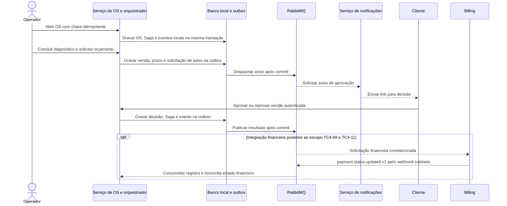

# ADR-0001 — Estratégia de Saga para o fluxo de Ordem de Serviço

- Item: **TC4-08 — Definir estratégia do Saga Pattern**.
- Estado da decisão: histórica, substituída para a integração atual pela [Saga coreografada da Fase 4](../saga-minima.md), conforme contrato posterior do projeto. O restante registra a proposta original.
- Escopo: orientar TC4-09 (criação da OS), TC4-10 (orçamento) e TC4-11 (aprovação), com integração posterior ao billing.

## Contexto observado

Este repositório contém a API de billing: criação/consulta de Pix e publicação de `payment.status.updated.v1` a partir de webhooks assinados do Mercado Pago. Não possui entidades de OS, orçamento, consumidor RabbitMQ, banco, outbox ou estado persistido de Saga.

No projeto local relacionado `tech_challenge`, `OrdemServicoService` já coordena criação de OS, geração de orçamento e aprovação/reprovação. `Orcamento` pertence ao agregado de OS. Os estados de OS incluem `Recebida`, `EmDiagnostico`, `AguardandoAprovacao`, `EmExecucao`, `Finalizada` e `Entregue`; o orçamento possui `Pendente`, `Aprovado` e `Reprovado`.

Essas operações ainda pertencem ao mesmo domínio e podem usar transações locais. A estratégia preserva essa fronteira. Se uma etapa passar a outro serviço, a comunicação seguirá os contratos e as regras de recuperação aqui definidos. Os nomes de participantes e de mensagens abaixo são contratos propostos; não indicam serviços ou filas já implementados.

## Decisão

Adotar **Saga orquestrada**, com um coordenador persistente hospedado no serviço responsável pela OS. Esse serviço decide a próxima etapa, registra o resultado e solicita compensações. O billing permanece responsável pelas cobranças e pelos estados financeiros.

O coordenador poderá inicialmente ser um módulo do serviço de OS, evitando um novo serviço apenas para hospedar o fluxo. Ele deverá sobreviver a reinícios usando persistência própria desse serviço. Sua implantação não ocorrerá dentro desta API de billing.

A orquestração mantém explícitos os passos, prazos e caminhos de falha. A alternativa de coreografia exigiria que cada participante decidisse os próximos passos, distribuindo essas regras entre consumidores. Esta escolha usa o modelo de [Saga orquestrada descrito pela Microsoft](https://learn.microsoft.com/en-us/azure/architecture/patterns/saga).

| Alternativa | Avaliação para este fluxo |
| --- | --- |
| Orquestração | Escolhida: uma máquina de estados registra criação, orçamento, decisão e recuperação. |
| Coreografia | Adiada: aumenta a distribuição das regras de sequência e compensação entre participantes. |
| Uma transação local | Deve continuar cobrindo operações dentro do mesmo agregado/banco. A Saga se aplica às fronteiras distribuídas. |

## Responsabilidades

| Participante lógico | Responsabilidade e dados próprios |
| --- | --- |
| Serviço de OS / orquestrador | Identidade da OS, `sagaId`, estado do processo, versão de concorrência, etapas, prazos, correlação e compensações. |
| Domínio de orçamento | Cálculo a partir de preços confiáveis, versão e validade do orçamento, decisão sobre a versão apresentada. Inicialmente pode permanecer no serviço de OS. |
| Entrada de aprovação | Autenticar o cliente e encaminhar aprovação/reprovação da versão vigente. Link ou webhook deve validar autorização; conhecer um ID não autoriza aprovar. |
| Billing (esta API) | Criar/consultar cobranças e publicar estado financeiro. Aprovação do orçamento e confirmação de pagamento são fatos separados. |
| Notificações | Enviar aviso para aprovação após orçamento persistido; falha no envio deve ser retentada sem recriar o orçamento. |

Nenhum serviço escreve diretamente no banco de outro. A coordenação ocorre por mensagens; operações que continuam locais usam chamadas de aplicação e uma transação no próprio serviço.

## Fluxo e estados

Uma instância representa uma tentativa de abertura e aprovação de OS. Revisar um orçamento exige uma nova versão; reabrir uma tentativa encerrada exige uma nova instância, vinculada à OS original para auditoria.

Os estados abaixo pertencem à Saga, separados de `StatusOrdemServico` e `StatusOrcamento`. Estados de compensação/cancelamento ainda precisam de regras e operações no domínio; não existem hoje nos enums de OS.

| Estado da Saga | Resultado aceito | Próxima ação / estado |
| --- | --- | --- |
| `CriandoOs` | `OsCriada` | Persistir `osId`; aguardar diagnóstico e solicitação de orçamento em `AguardandoDiagnostico`. |
| `CriandoOs` | `CriacaoOsRecusada` | Encerrar em `Falhou`, sem compensar uma OS que não foi criada. |
| `AguardandoDiagnostico` | `GeracaoOrcamentoSolicitada` | Validar etapa da OS e versão; iniciar `GerandoOrcamento`. |
| `GerandoOrcamento` | `OrcamentoGerado` | Registrar valores/versão/validade; ir para `AguardandoAprovacao` e solicitar aviso ao cliente. |
| `GerandoOrcamento` | `GeracaoOrcamentoRecusada` | Registrar falha de negócio e iniciar `Compensando` se a tentativa precisar ser desfeita. |
| `AguardandoAprovacao` | `OrcamentoAprovado` da versão vigente e dentro do prazo | Encerrar em `Aprovada`. Publicar o resultado para os fluxos seguintes. |
| `AguardandoAprovacao` | `OrcamentoReprovado` da versão vigente | Encerrar em `Reprovada`, preservando OS, orçamento e decisão para consulta. |
| `AguardandoAprovacao` | Prazo de validade atingido | Invalidar a versão e encerrar em `Expirada` após confirmação da invalidação. |
| Etapa com efeito possivelmente confirmado | Falha técnica sem resultado conhecido | Ir para `Reconciliando`; consultar/repetir a mesma operação idempotente antes de decidir compensar. |
| `Compensando` | Todas as compensações confirmadas | Encerrar em `Compensada`. |
| `Compensando` ou `Reconciliando` | Recuperação automática esgotada | Ir para `IntervencaoNecessaria`, com motivo e alerta para operação. |

`Aprovada`, `Reprovada`, `Expirada`, `Compensada` e `Falhou` são estados terminais desta tentativa. `IntervencaoNecessaria` mantém o processo suspenso para recuperação auditada.

A aprovação de uma versão vence a expiração apenas se persistida dentro do prazo. Ambas usam a mesma versão de concorrência: uma atualização confirma, a outra recarrega e respeita o resultado vencedor. Uma nova mensagem não reabre uma tentativa terminal. Resultados tardios de uma etapa ainda devem ser registrados e reconciliados para compensar efeitos realmente produzidos; nunca basta descartá-los.



O diagrama mostra o orçamento ainda local ao serviço de OS. Se esse domínio for separado, `GerarOrcamento` e seu resultado passam pelo RabbitMQ, preservando a mesma máquina de estados.

## Contratos e correlação

| Etapa | Comando / intenção | Resultado de negócio |
| --- | --- | --- |
| TC4-09 | `os.create.v1` | `os.created.v1` ou `os.creation-rejected.v1` |
| TC4-10 | `budget.generate.v1` | `budget.generated.v1` ou `budget.generation-rejected.v1` |
| TC4-11 | `budget.approve.v1` / `budget.reject.v1` | `budget.approved.v1` / `budget.rejected.v1` |
| Expiração / compensação | `budget.invalidate.v1`, `os.cancel-opening.v1` | `budget.invalidated.v1`, `os.opening-cancelled.v1` ou resultado explícito de falha |

Esses nomes serão usados nas fronteiras distribuídas. Não é necessário enviar uma mensagem RabbitMQ para invocar o próprio agregado no mesmo processo; nesse caso o resultado local é registrado atomicamente com a Saga e sua outbox.

Para novos contratos, usar envelope JSON versionado:

```json
{
  "messageId": "39b0ceaa-97c6-4714-9747-3338d9fc9aba",
  "messageType": "budget.generated.v1",
  "sagaId": "d6cd73f8-8093-4359-9494-8b79cfb545ed",
  "correlationId": "d6cd73f8-8093-4359-9494-8b79cfb545ed",
  "causationId": "2a54dfd7-9bbd-4dd5-999e-d94bad278f44",
  "occurredAt": "2026-11-16T15:00:00Z",
  "aggregateVersion": 2,
  "payload": {
    "osId": "OS-123",
    "budgetVersion": 1,
    "amount": 150.00,
    "currency": "BRL",
    "expiresAt": "2026-11-23T15:00:00Z"
  }
}
```

- `sagaId`: criado e persistido na entrada do fluxo; `correlationId` é igual a ele neste processo.
- `messageId`: identifica a mensagem lógica; permanece igual ao republicar a mesma mensagem da outbox.
- `causationId`: identifica o comando/evento que originou a mensagem. A entrada externa não tem causador e pode usar `null`.
- `aggregateVersion`: versão da entidade que produziu o resultado; validada junto com etapa e versão do orçamento.
- Retentativas de um comando preservam identidade, payload e chave idempotente. A versão do orçamento faz parte da identidade da aprovação.

## Integração com o contrato atual do billing

Preservar `payment.status.updated.v1`, a exchange `billing.events` e sua routing key. O contrato atual usa `eventId`, `observedAt`, `paymentId`, `orderId`, `amount`, `status` e `statusDetail`; ele não contém o envelope da Saga. O novo envelope acima não deve ser interpretado como alteração do evento existente.

O serviço que solicitar a cobrança deverá persistir o vínculo entre `sagaId`, ID da OS, versão de orçamento, referência enviada em `CreatePixRequest.OrderId`, chave de idempotência e `paymentId` devolvido pelo Mercado Pago. A referência deve atender à validação atual de até 64 letras, números, hífens ou sublinhados. Reservar e persistir a referência e a chave antes da chamada externa; completar o vínculo ao receber a resposta.

O consumidor localizará a tentativa pelo vínculo persistido e deduplicará o evento pelo `eventId`. Se o vínculo ainda não estiver completo, deve reconciliar usando a referência reservada e o resultado da operação original; não atribuir o evento à OS mais recente por aproximação. `orderId=null`, vínculo inexistente ou divergência de valor exigem reconciliação/intervenção.

`observedAt` representa uma observação e não ordena transições financeiras. Eventos tardios, incompatíveis com o estado conhecido ou de uma tentativa anterior exigem consulta à fonte de verdade. O mesmo `eventId` pode reaparecer para o mesmo estado: ele serve à deduplicação de efeitos, não a reconstruir um histórico completo de transições.

TC4-09 a TC4-11 terminam na decisão do orçamento. A aprovação não exige automaticamente pagamento nem altera por si só a política de início da execução já existente. A integração financeira posterior deve definir essa política antes de bloquear ou liberar a OS. Um novo envelope financeiro deverá usar contrato versionado próprio se necessário.

## Consistência, persistência e recuperação

O orquestrador e os futuros participantes com escrita local deverão implementar:

1. **Transação local:** estado de negócio, estado da Saga e mensagens de saída gravados atomicamente. Se orçamento continuar no agregado de OS, compartilham essa transação.
2. **Outbox persistente:** despachante publica depois do commit com confirmação do broker e `mandatory=true`; só marca a saída como enviada após confirmação. Reinício pode republicar a mesma mensagem.
3. **Inbox persistente:** restrição única por consumidor e `messageId` (ou `eventId` no billing v1). Registrar recebimento, efeitos, progresso e nova outbox na mesma transação. Enviar ACK após commit; deduplicação em memória não atende ao requisito.
4. **Concorrência otimista:** atualizar estado apenas na versão esperada; colisão recarrega o processo e reavalia se a mensagem ainda se aplica. Um identificador de Saga acompanha todas as etapas, sem depender da ordem global de entrega.
5. **Prazos persistidos:** `deadlineAt`, instante da última tentativa e número de tentativas sobrevivem ao reinício. Um worker busca prazos vencidos; não depender de temporizador em memória nem manter transação aberta esperando o cliente.

Modelo mínimo do coordenador: `SagaInstance` (`sagaId`, referência externa idempotente, `osId`, `state`, `version`, `budgetVersion`, `deadlineAt`, `lastError`, datas), `SagaStep` (identidade da operação, resultado e compensação), `InboxMessage` e `OutboxMessage`. Armazenamento relacional transacional é a opção inicial; o banco pertence ao serviço de OS, sem compartilhamento entre serviços.

Política inicial para erros transitórios: tentativa original e três retentativas após 5 s, 30 s e 2 min, com jitter. Persistir o agendamento e a contagem; não usar requeue imediato em loop. Falha de validação, autorização ou decisão de reprovação não é retentada como erro técnico. Após o limite, mover a mensagem para tratamento de erro e persistir `Reconciliando`/`IntervencaoNecessaria` conforme o resultado conhecido. Uma indisponibilidade técnica não comprova que o efeito deixou de ocorrer.

Cada comando externo terá um prazo inicial de resultado de 5 minutos, configurável por etapa. Ao vencer sem resultado, reconciliar a mesma operação; não criar outra OS nem cancelar um efeito ainda desconhecido. Validade inicial proposta do orçamento: 7 dias, registrada em `expiresAt` por versão. São parâmetros para implementação do épico e podem ser ajustados por requisito de negócio.

Topologia proposta para fronteiras distribuídas: exchange topic durável `service-order.commands`, uma fila por participante; exchange `service-order.events` com filas independentes para orquestrador e demais assinantes. Cada consumidor terá filas de retentativa/erro e alertas. Não reutilizar `billing.payment-status` como fila compartilhada por serviços que precisam receber todos os eventos; cada assinatura tem fila própria vinculada a `billing.events`.

Esses recursos são futuros. O `compose.yaml` atual sobe apenas o broker. A API atual de billing ainda depende da reentrega do webhook e não oferece outbox/inbox nem consumer; essa lacuna deve ser resolvida quando ela passar a executar comandos da Saga.

## Compensações e falhas de negócio

Uma compensação é uma ação de negócio persistida, repetível e auditada. Pode falhar e exigir intervenção; não equivale a desfazer commits de outros bancos. Esta política segue o [padrão de transação compensatória da Microsoft](https://learn.microsoft.com/en-us/azure/architecture/patterns/compensating-transaction).

| Situação | Política definida |
| --- | --- |
| OS recusada antes de persistir | Encerrar a tentativa com o motivo, sem cancelar outra OS. |
| Falha definitiva na geração de orçamento após OS criada | Invalidar versão parcial, se houver; compensar a abertura conforme operação de domínio futura. Preservar histórico e nunca apagar a OS fisicamente. |
| Cliente reprova | Registrar `Reprovada`, preservar orçamento e decisão. É resultado normal do processo; não acionar recuperação de erro técnico. |
| Cliente não decide no prazo | Invalidar a versão pendente cuja validade expirou, confirmando que ainda não houve aprovação concorrente; registrar `Expirada`. |
| Aviso ao cliente falha | Retentar o aviso usando o mesmo orçamento; não cancelar a OS por falha isolada de e-mail. |
| Falha depois de uma aprovação já confirmada | Reconciliar ou continuar a etapa seguinte; não transformar silenciosamente uma aprovação em reprovação. |
| Compensação falha | Persistir progresso, retentar a mesma ação e, ao esgotar, alertar em `IntervencaoNecessaria`. |
| Cobrança com resposta incerta em integração futura | Consultar/repetir a operação com a mesma chave idempotente. Confirmar o resultado antes de decidir cancelamento. |
| Pagamento já confirmado em integração futura | Reembolso é uma operação financeira própria, com regras e idempotência; não presumir reversão por cancelar a OS. A API atual ainda não implementa cancelamento/reembolso. |

`budget.invalidate.v1` e `os.cancel-opening.v1` precisam de implementação e resultados explícitos antes de habilitar compensação automática. Reabertura, cancelamento e efeitos no estoque devem ser definidos no domínio responsável; não presumir reservas de estoque que não existem neste fluxo.

## Observabilidade e critérios de aceite

Logs devem conter `sagaId`, IDs de mensagem/causador, OS, versão de orçamento, etapa, tentativa e resultado. Não registrar credenciais, dados Pix ou payload completo do pagador. Medir instâncias por estado, tempo por etapa, atrasos da outbox, retentativas, erros em filas e intervenções pendentes.

| Item | Critério para a implementação |
| --- | --- |
| TC4-08 | Decisão, responsabilidades, estados, contratos, compensações, compatibilidade com billing e plano de testes documentados e ligados ao README. |
| TC4-09 | Mesma chave/payload retorna a mesma OS/Saga; payload diferente conflita; commit inclui outbox; reinício retoma o fluxo sem duplicar criação. |
| TC4-10 | Orçamento deriva de dados confiáveis; versão é imutável para uma decisão; duplicata não recalcula nem envia outro aviso como novo efeito; falha tem resultado explícito. |
| TC4-11 | Apenas cliente autorizado decide versão vigente dentro do prazo; repetição é idempotente; decisão conflitante é recusada; aprovação/expiração concorrentes têm um único vencedor. |
| Recuperação | Testar queda antes/depois de commit/publicação/ACK, broker indisponível, mensagem duplicada/fora de ordem, prazo vencido, efeito tardio e falha da compensação. |
| Billing posterior | Testar correlação por OS/versão/tentativa, valor divergente, resposta incerta, reentrega do mesmo estado e preservação do contrato `payment.status.updated.v1`. |

## Entrega e limites

Esta entrega conclui a definição da estratégia TC4-08. TC4-09, TC4-10 e TC4-11 continuam pendentes de implementação nos serviços responsáveis. Os testes existentes desta API cobrem billing/RabbitMQ e não comprovam a execução da Saga.

Próximos passos: persistência do coordenador e inbox/outbox no serviço de OS; criação idempotente; geração de orçamento versionado; entrada de aprovação autorizada; workers de prazos/recuperação; depois integração financeira conforme regra de negócio. O projeto local `tech_challenge` foi consultado como referência de domínio; nenhum arquivo dele é alterado por esta decisão.
