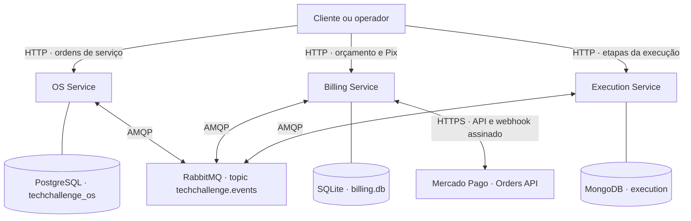

# Arquitetura final — Tech Challenge, Fase 4

Os serviços de Ordem de Serviço (OS), Faturamento (Billing) e Execução (Execution) acompanham uma mesma ordem desde a abertura até a conclusão do trabalho. Cada serviço mantém seu próprio estado e publica eventos no RabbitMQ quando ocorre uma mudança relevante para os demais. O Billing também integra o pagamento Pix com o Mercado Pago.

## 1. Diagrama geral

As APIs HTTP atendem operações e consultas. Entre os três serviços, a Saga se comunica por eventos do RabbitMQ. Cada serviço publica na exchange `techchallenge.events` e consome de sua própria fila durável (`os-service.events`, `billing-service.events` ou `execution-service.events`). Cada API lê e grava apenas seu próprio banco.

| Routing key | Publicador | Consumidores | Efeito |
| --- | --- | --- | --- |
| `os.criada` | OS | Billing | Registra o contexto da ordem para receber orçamento. |
| `billing.aprovado` | Billing | OS e Execution | Avança a OS para `EmExecucao` e cria a execução em `Pendente`. |
| `billing.reprovado` | Billing | OS | Coloca ou mantém a OS em `AguardandoAprovacao` após a recusa explícita. |
| `execution.finalizada` | Execution | OS | Avança a OS de `EmExecucao` para `Finalizada`. |
| `execution.falhou` | Execution | OS e Billing | Registra a compensação na OS em execução e aciona a reconciliação financeira. |

Os eventos da Saga são JSON com `eventId` (UUID da mensagem), `ordemServicoUniqueCode` (UUID que correlaciona a ordem nos três serviços) e `occurredAt` (data e hora UTC). `execution.falhou` também pode incluir `motivo`. O webhook do Billing publica ainda o evento financeiro `payment.status.updated.v1` na fila `billing.payment-status`. A exchange desse evento é configurável, com padrão `billing.events` e sobrescrita para `techchallenge.events` no Compose do Billing. Os consumidores da Saga usam as routing keys da tabela.

### Execução local com Docker Compose

| Repositório | API no host | Infraestrutura definida no Compose |
| --- | --- | --- |
| `tech-challenge-execution-service` | `localhost:8080` | MongoDB 7 e RabbitMQ 3 com painel de administração. |
| `tech-challenge-os-service` | `localhost:8081` | PostgreSQL 16 e conexão ao broker compartilhado. |
| `tech-challenge-billing-service` | `localhost:8082` | SQLite no volume `billing_data` e conexão ao broker compartilhado. |

O Compose do Execution cria a rede `tech-challenge-execution-service_default`. Os Composes de OS e Billing usam essa rede externa para alcançar o host `rabbitmq`. Para executar o fluxo integrado, suba o Compose do Execution primeiro, aplique as migrations do PostgreSQL da OS e aguarde a inicialização dos três consumidores antes de abrir uma ordem. O Billing aceita o provedor Fake para simular pagamentos e estornos em `Development` e `Testing`.

## 2. Saga Pattern por coreografia

A estratégia implementada é **coreografia**. Cada participante decide como reagir aos eventos que recebe, grava seu estado local e publica os resultados do seu domínio. O fluxo usa transações locais e consistência eventual. A publicação de `billing.aprovado`, por exemplo, permite que OS e Execution avancem de forma independente, cada um na sua própria fila. O [ADR-0001](adr-0001-saga-os.md) registra a proposta histórica de orquestração, substituída pela coreografia implementada nos três serviços.

A coreografia é adequada a este fluxo porque ele envolve três domínios e um conjunto pequeno de eventos. O Billing usa o mesmo evento de aprovação para informar OS e Execution, e cada assinante aplica sua própria regra. Isso concentra as regras de cada etapa no serviço responsável e evita manter um processo central para comandar e persistir todas as transições. Em troca, o estado completo da operação fica distribuído, e o diagnóstico de atrasos ou falhas depende da correlação pela OS entre logs, filas e bancos.

### Fluxo normal e reprovação

1. O **OS Service** recebe `POST /api/v1/ordens-servico`, grava a ordem no PostgreSQL e publica `os.criada`.
2. O **Billing** consome o evento e registra a ordem no SQLite. Um operador ou cliente da API informa o valor do orçamento em `POST /api/billing/ordens/{guid}/orcamento` e solicita o Pix em `POST /api/billing/ordens/{guid}/aprovar`, com a chave `X-Idempotency-Key`.
3. O **Billing** confirma pelo provedor que o pagamento está `processed`/`accredited` e corresponde à OS e ao valor do orçamento. Com Mercado Pago, a confirmação pode ser detectada pelo webhook com consulta à Orders API ou pelo worker de reconciliação. O Billing então registra a aprovação e envia `billing.aprovado` pela outbox.
4. O **OS Service** coloca a ordem em `EmExecucao` e o **Execution** cria a sua execução em `Pendente`. O Execution registra diagnóstico e reparo, e publica `execution.finalizada` após persistir a finalização. O OS recebe o evento e atualiza a ordem para `Finalizada`.

Se houver recusa explícita antes de iniciar a cobrança, `POST /api/billing/ordens/{guid}/reprovar` gera `billing.reprovado`. A OS permanece em `AguardandoAprovacao`, e o Execution cria a execução somente a partir de `billing.aprovado` no fluxo da Saga.

### Falha e compensação

O Execution pode publicar `execution.falhou` por falha de negócio ao criar a execução ou pela rota `PATCH /api/v1/execucoes/os/{uniqueCode}/falha`. Ao consumir o evento para uma ordem em `EmExecucao`, o OS grava uma compensação `Pendente` em `ordem_servico_compensacao` e bloqueia novas progressões da ordem por eventos.

O Billing registra a solicitação e consulta o estado financeiro. Se o Pix está pendente e pode ser cancelado, solicita cancelamento. Se o pagamento está confirmado, solicita estorno integral. Se nenhuma cobrança foi iniciada, registra `not_applicable`. Após confirmar o resultado com o provedor, registra `cancelled` ou `refunded`. A confirmação financeira pode ser consultada em `GET /api/billing/ordens/{guid}` no campo `compensationStatus`. O contrato atual encerra a reconciliação no Billing, sem publicar um evento de conclusão para atualizar o registro `Pendente` na OS.

### Entrega e recuperação

| Serviço | Mecanismo implementado | Limite operacional |
| --- | --- | --- |
| OS | Grava `processed_event` por `eventId` na mesma transação que aplica o evento à ordem. Tenta novamente falhas transitórias do consumidor por até três tentativas totais. | Publica `os.criada` após o commit, sem outbox. Se a publicação falhar, a OS permanece gravada e a falha é registrada em log. |
| Billing | Persiste inbox e mudança local antes do ACK. Grava decisões e outbox na mesma transação e retenta eventos até confirmar a publicação. Reutiliza chaves de idempotência nas operações de pagamento e compensação. | Retentativas de reconciliação têm limite de falhas e podem exigir `manual_review`. A implementação com SQLite e sincronização em processo opera com uma réplica. |
| Execution | Mantém índice único por OS no MongoDB para deduplicar a criação. Na rota de falha, persiste o ID do evento e reutiliza o mesmo ID ao repetir a chamada após erro de publicação. | Publica `execution.finalizada` após persistir, sem outbox. Se a publicação falhar, a execução permanece finalizada e a falha é registrada em log. |

Cada consumidor tem uma fila de erro (`.error`) para mensagens rejeitadas sem reenfileiramento. O tratamento de falha transitória varia por serviço. Por exemplo, o Execution reenfileira o evento de entrada em caso de falha de infraestrutura. A outbox do Billing pode republicar o mesmo evento se o processo cair após a confirmação do RabbitMQ e antes de marcar a mensagem como enviada.

## 3. Divisão dos serviços e tecnologias

| Serviço | Motivo da divisão | Tecnologia e justificativa |
| --- | --- | --- |
| **OS Service** | É a fonte do estado da ordem e dos seus itens. O ciclo de atendimento e a entrega são responsabilidades da OS. | **PostgreSQL**, **EF Core** e **Npgsql** atendem ao modelo relacional de ordens e itens e permitem gravar a atualização da ordem e o registro de processamento do evento juntos. A API de OS usa **JWT Bearer** para autenticação. |
| **Billing Service** | Centraliza o valor do orçamento, o estado da cobrança e as regras de cancelamento e estorno. As chamadas, notificações e falhas do provedor de pagamento são tratadas nesse serviço. | **SQLite** com `Microsoft.Data.Sqlite` permite persistir contexto, inbox e outbox em um arquivo e aplicar as mudanças em transações locais. É adequado à implantação atual com uma réplica. A **Orders API do Mercado Pago** fornece Pix, consulta, cancelamento e estorno. |
| **Execution Service** | Mantém o estado operacional do trabalho, com diagnóstico, reparo, conclusão ou falha. A execução tem um ciclo próprio vinculado à ordem pelo seu código. | **MongoDB** com `MongoDB.Driver` armazena uma execução por documento, com status, datas das transições e dados de publicação da falha. O índice único pelo código da OS protege a criação contra duplicatas. |

- **C# e ASP.NET Core sobre .NET 10** fornecem uma base comum para APIs HTTP, injeção de dependências e workers. OS e Billing usam controllers, e Execution usa Minimal APIs.
- **RabbitMQ** com `RabbitMQ.Client` permite que OS, Billing e Execution processem mensagens em ritmos diferentes. A exchange `topic` roteia cada evento aos assinantes, inclusive a aprovação e a falha de execução, que têm dois destinatários.
- **Docker e Docker Compose** descrevem a execução local das APIs e suas dependências, com volumes para preservar os dados e uma rede compartilhada para o broker.

### Referências no código

- **OS:** `tech-challenge-os-service/src/TechChallenge.OS.Infrastructure/Messaging/IntegrationEventHandler.cs` e `PublishingOrdemServicoApplicationService.cs`, no mesmo diretório.
- **Billing:** [regras da Saga](../../src/Billing.Api/Saga/BillingSagaService.cs), [persistência](../../src/Billing.Api/Saga/BillingSagaStore.cs) e [worker RabbitMQ](../../src/Billing.Api/Saga/BillingSagaRabbitMqWorker.cs).
- **Execution:** `tech-challenge-execution-service/src/TechChallenge.Execution.Application/ExecucaoService.cs`, `Messaging.cs` no mesmo diretório e `src/TechChallenge.Execution.Api/Program.cs` para as rotas.
